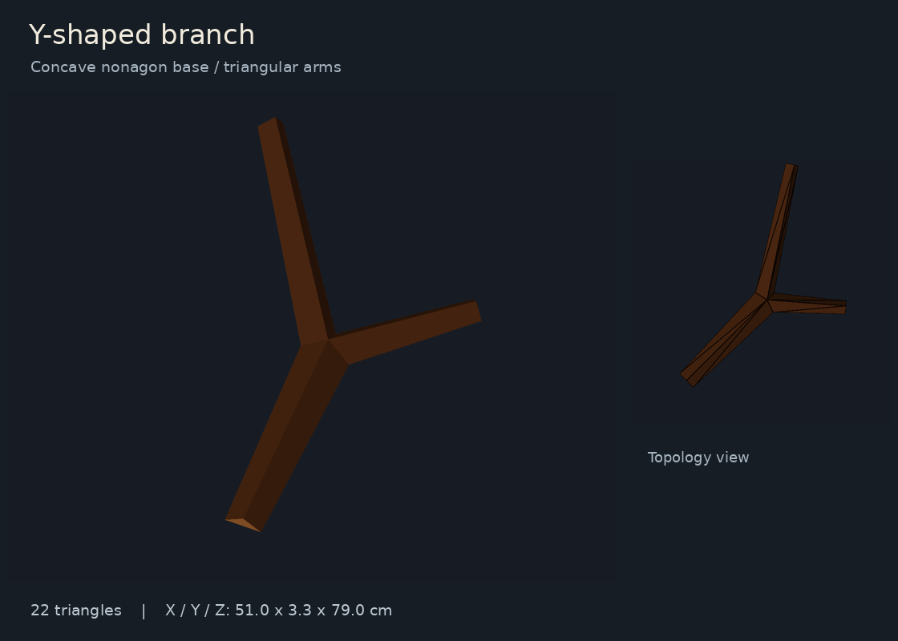
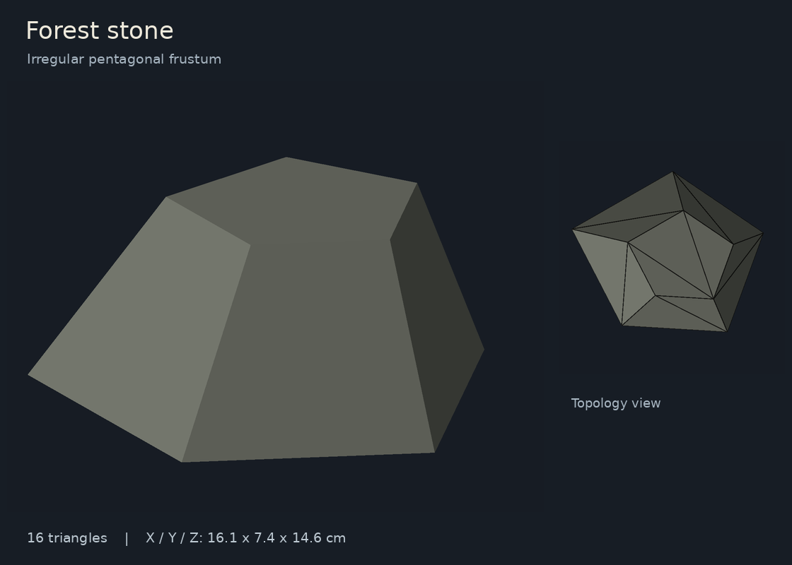
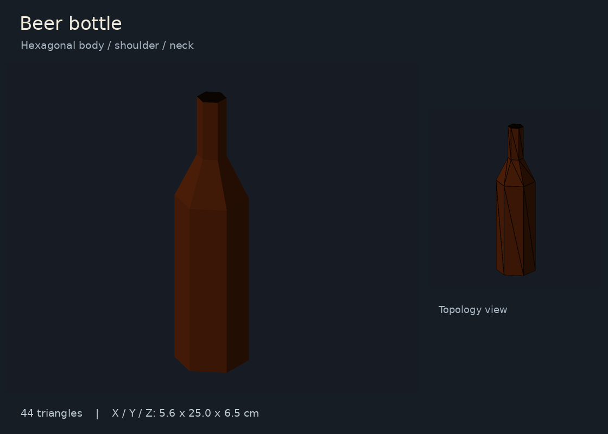

# Low-poly ground assets

Three original, texture-free meshes for [streamed forest ground clutter](../../docs/DOODADS.md)
in the standalone viewer. All geometry is authored locally and dedicated to
CC0 1.0.

| Asset | Geometry | Triangles | Dimensions (X × Y × Z) |
| --- | --- | ---: | --- |
| `branch.glb` | Concave nine-corner underside; triangular arms with one shorter fork | 22 | 51 × 3.3 × 79 cm |
| `stone.glb` | Irregular pentagonal frustum, smaller offset upper pentagon | 16 | 16.1 × 7.4 × 14.6 cm |
| `beer_bottle.glb` | Hexagonal body column, shoulder frustum and neck column | 44 | 5.6 × 25 × 6.5 cm |

Coordinates are X east, Y up, Z south, in meters. Each asset rests on Y=0 near
its local origin; the bottle is upright and can be rotated onto its side when
placed. The branch lies along Z, with its shorter fork extending toward +X.
Materials use flat normals, single-sided opaque surfaces and no textures. The
bottle uses amber coloring and a dark, closed top face suggesting its mouth;
there is no hollow interior or extra cap geometry.

The reproducible source is [doodad_geometry.py](../../src/doodad_geometry.py);
[doodad_assets.py](../../src/doodad_assets.py) handles validation and export.
Generated GLBs follow the repository's existing binary ignore rule. Build them
without downloads or third-party dependencies:

```bash
python3 tools/create_doodad_assets.py
```

Render the previews using the pinned project environment:

```bash
.venv/bin/python tools/create_doodad_assets.py --previews
```

`--output-dir` selects another destination. The builder validates outward winding,
closed edges and nondegenerate triangles after float32 conversion, across
material boundaries, before replacing any GLB. Focused checks inspect the actual
exported shapes:

```bash
.venv/bin/python -m unittest discover -s tests -p 'test_doodad_assets.py' -v
```

Previews below are CPU renders of the exported GLBs, with an additional outlined
view. Each asset is framed independently; sizes are not comparable between
images. Lighting is illustrative and does not simulate glass transmission or
PBR reflections.






